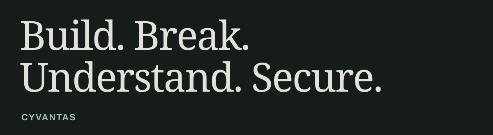

# Prajeesh KC

**Cybersecurity research, Python tooling, and AI security agents.**

<picture>
  <source media="(max-width: 600px)" srcset="assets/hero-mobile.svg" />
  
</picture>

I build Python tools to investigate how applications work, test them within an authorized scope, and turn findings into evidence developers can use. [CYVANTAS](https://cyvantas.in) is my cybersecurity brand and the home for that work.

**Start here: [Explore Vibe PentesterLab →](https://github.com/kcprajeesh/Vibe-pentesterlab)**

## Selected work

### [Vibe PentesterLab](https://github.com/kcprajeesh/Vibe-pentesterlab)

My main project: a Python application security toolkit combining source analysis, LLM reasoning, and findings with supporting evidence. The V4 CLI exports Markdown, JSON, and SARIF reports, with explicit authorization for live targets.

```sh
vibe scan ./my-project \
  --format markdown --format sarif \
  --output ./reports
```

The current Docker sandbox performs bounded Python source checks. Full application execution and browser testing are [roadmap work](https://github.com/kcprajeesh/Vibe-pentesterlab#roadmap).

### [Cyvantas AI Agent](https://github.com/kcprajeesh/CyvantasAlAgent)

An application security agent project extending Pentest Agent Suite with a Python control plane for authorization, target scope, execution policy, and evidence handling. It explores how AI-assisted testing can stay bounded and reviewable.

[Inspect the policy engine](https://github.com/kcprajeesh/CyvantasAlAgent/blob/main/cyvantas/security/policy.py) · [Explore the task graph](https://github.com/kcprajeesh/CyvantasAlAgent/blob/main/cyvantas/orchestration/task_graph.py)

### [CyvantasForge](https://github.com/kcprajeesh/CyvantasForge)

A related Python application security toolkit organized into analysis, runtime, and reporting modules. Its offline mock provider makes the pipeline usable for deterministic dry runs without an API key.

[Explore the package](https://github.com/kcprajeesh/CyvantasForge/tree/main/cyvantasforge) · [Inspect the mock provider](https://github.com/kcprajeesh/CyvantasForge/blob/main/cyvantasforge/llm/mock.py)

## How I approach security

> A finding should come with evidence.

I’m interested in the path from a suspicious pattern to a reproducible finding: understand the application, check the hypothesis, preserve the evidence, and explain the fix. My projects are where I develop that workflow.

- **Application security:** source analysis, vulnerability research, and authorized testing.
- **AI and automation:** scoped agent workflows, repeatable checks, and useful reports.
- **Developer tooling:** Python CLIs, Shell, Linux, Docker, Git, and GitHub Actions.

**Exploring next:** stronger runtime validation and more reliable evaluation of AI security agents.

<details>
<summary>Contribution activity</summary>

<picture>
  <source media="(prefers-reduced-motion: reduce)" srcset="assets/activity-static.svg" />
  <source media="(prefers-color-scheme: dark)" srcset="https://raw.githubusercontent.com/kcprajeesh/Kcprajeesh/output/github-contribution-grid-snake-dark.svg" />
  
</picture>

[View contribution history on GitHub](https://github.com/kcprajeesh?tab=overview)

</details>

## Connect

[CYVANTAS](https://cyvantas.in) · [GitHub](https://github.com/kcprajeesh) · [X](https://x.com/prajeesh_kc) · [Instagram](https://instagram.com/prajeesh_kc)

**Build with curiosity. Test with permission. Leave a useful explanation.**
